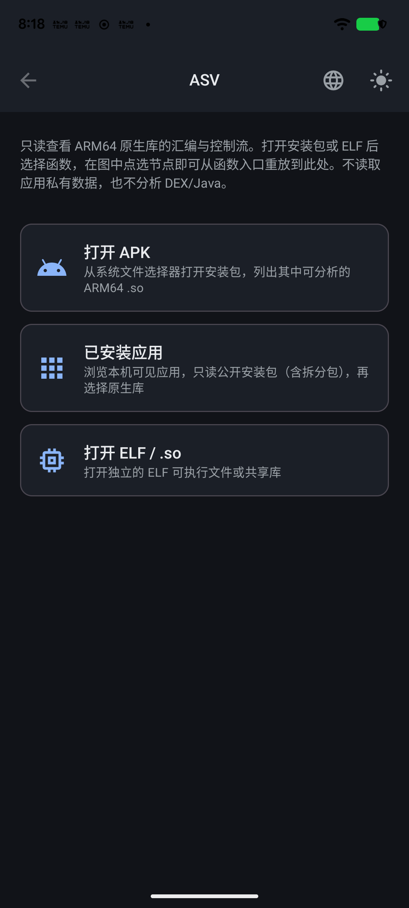
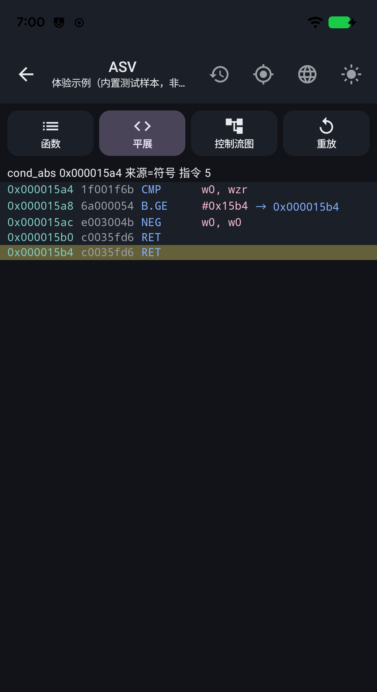
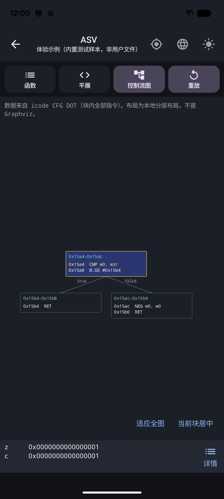

# ASV

ASV is a phone-first Android app for viewing ARM64 ELF / `.so` assembly, a
linear listing, a control-flow graph, and a read-only replay of changed
registers. Replay uses a default execution environment (the same kind of
seeding used for indirect-branch resolution). There is no register-edit UI.
This is meant for watching value changes while working on deobfuscation.

This repository is the **application** project: Kotlin, resources, Gradle, and
a **prebuilt** `libicode_jni.so`. It does **not** contain the analysis engine
source, headers, CMake, or static libraries (`.a`). Release APKs are not
committed; get them from a GitHub Release asset when one is published, or
build `assembleRelease` locally.

Version: **1.0.9** (versionCode 10). ABI: `arm64-v8a` only. The minimum
supported OS is Android 8.0 (API 24). Device testing for this release was
done on a Pixel 6; that is **not** a claim that an API 24 device was tested.

## Screenshots

These are real UI screens (Chinese), not mockups. The layout is unchanged from 1.0.8.

<p>





</p>

- Home: open an APK, an installed app, or a standalone ELF / `.so`, or load the built-in sample.
- Listing: compact address / bytes / instruction rows; long-press a row to copy it.
- Control-flow graph: local layout, pinch-zoom and pan.
- Replay: starts at the function entry and follows the instructions that actually run (including branches and calls that stay inside the mapped image). The main view lists only registers that actually changed; **Details** on the right opens a full-screen page with each instruction in trace order (for example `x0:5→12`). If the selected instruction is not reached under the default environment, the app says so and still shows the steps that did run. Instructions that cannot be executed are reported as unsuccessful, not as a successful result.

## Build

Requirements: JDK 17, Android SDK (compile/target SDK 35, min SDK 24), and the
official Gradle wrapper in this repo (Gradle 8.11.1). The first build needs
network access to Google / Maven Central.

You do **not** need the engine source tree, `ICODE_*` environment variables,
or CMake/NDK compilation of native code.

```bash
# In a local.properties file (not committed), set:
#   sdk.dir=/path/to/Android/sdk

./gradlew :app:assembleDebug
./gradlew :app:assembleRelease
```

Debug APK: `app/build/outputs/apk/debug/`. Release APK:
`app/build/outputs/apk/release/`. Do not commit APKs.

Release builds need a local signing config. Do not put keystore passwords in
the repository. Set `ASV_RELEASE_SIGNING_PROPS` to an untracked properties
file with `storeFile`, `storePassword`, `keyAlias`, and `keyPassword`, or use
the default local signing properties path on the build machine (outside this
repo).

The native library is already under
`app/src/main/jniLibs/arm64-v8a/libicode_jni.so` (plus `libc++_shared.so`).
The Kotlin side loads it with `System.loadLibrary("icode_jni")`.

## Limits and what was tested

- Replay is read-only and uses a default environment; there is no register editor and no extra settings screen.
- Replay follows the path the default environment actually takes. Untaken branches are not forced. A selected instruction off that path is reported as not reached; the details page still lists the instructions that did run. A mapped call is followed; if a call overwrites the return address and execution cannot return, later instructions in the caller are not invented.
- The prebuilt engine library is **not** open-sourced by this repository. The
  binary was stripped of ELF debug symbols; that does **not** mean it cannot
  be reverse engineered, and some third-party path strings may remain. See
  `NOTICE`.
- 1.0.9 replay and details were instrumented on a Pixel 6 (arithmetic, condition flags, stack, taken and untaken branches, indirect targets, failure handling, and the full-screen details page). Large-CFG stress and replay-cancel were **not
  covered** (analysis finished too quickly to show a cancel control). Do not
  treat those as passing tests.
- The release signing key is not the same as the earlier debug key, so this
  APK cannot be installed as an in-place update over an existing debug build.

## Instrumentation tests

Tests run on a device or emulator with `am instrument`. Some tests copy a
self-made `libconst_twelve.so` from public Download storage on the test
device (`Download/ASV-test` or `Download/icode-viewer-test`). They do not
read engine source.
