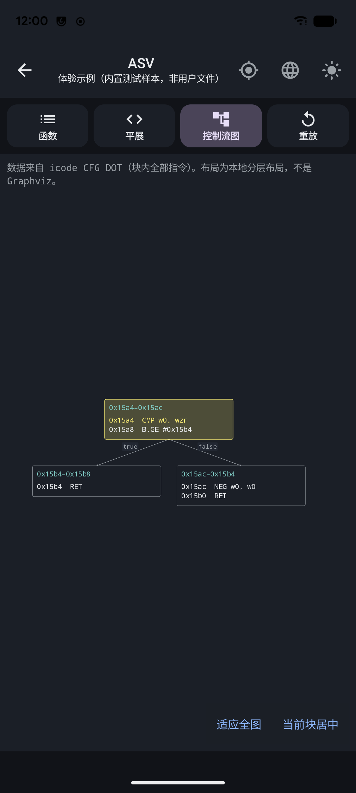
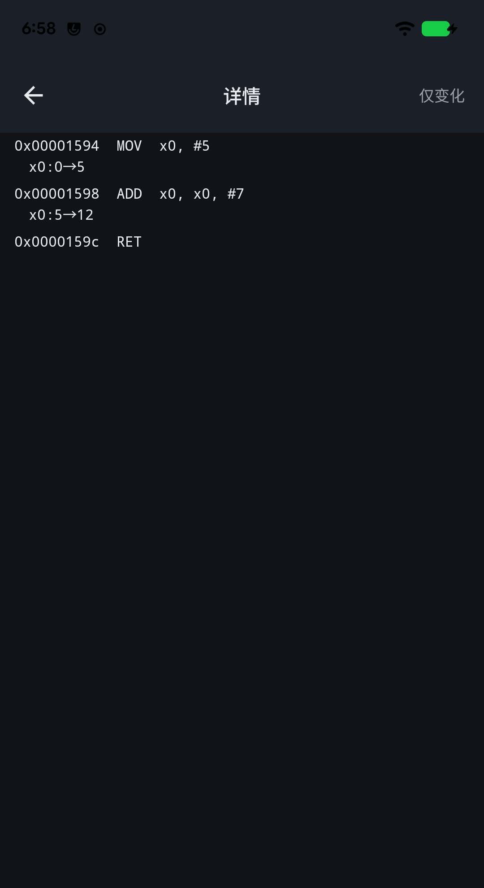

# ASV

ASV is a phone-first Android app for viewing ARM64 ELF / `.so` assembly, a
linear listing, a control-flow graph, and a read-only replay of changed
registers. Replay uses a default execution environment (the same kind of
seeding used for indirect-branch resolution). There is no register-edit UI.
This is meant for watching value changes while working on deobfuscation.

This repository is the **application** project: Kotlin, resources, Gradle, and
a **prebuilt** `libicode_jni.so`. It does **not** contain the analysis engine
source, headers, CMake, or static libraries (`.a`). Release APKs are not
committed; get them from a GitHub Release asset when one is published, or
build `assembleRelease` locally.

Version: **1.0.12** (versionCode 13). ABI: `arm64-v8a` only. The minimum
supported OS is Android 8.0 (API 24). Device testing for this release was
done on a Pixel 6; that is **not** a claim that an API 24 device was tested.

## Screenshots

These are real UI screens (Chinese), not mockups. The home screen shows the
three official import entries only.

<p>





</p>

- Home: open an APK, an installed app, or a standalone ELF / `.so`.
- Listing: a continuous, address-ordered view across function boundaries,
  with function labels in the list. Scroll to load more addresses within a
  bound. Long-press a row to copy it. Jump goes to a virtual address in this
  same list.
- Control-flow graph: after you tap a listing instruction, the graph is that
  instruction's function, with its block highlighted. If you only scroll,
  the graph follows the first visible instruction. An address that no known
  function owns does not reuse a previous graph. Pinch-zoom and pan still
  apply.
- Replay: starts at the function entry and follows the instructions that
  actually run (including branches and calls that stay inside the mapped
  image). The main view lists only registers that actually changed;
  **Details** on the right opens a full-screen page with each instruction in
  trace order and hexadecimal values (for example `x0:0xffffffff→0x1`). If
  the selected instruction is not reached under the default environment, the
  app says so and still shows the steps that did run. Instructions that
  cannot be executed are reported as unsuccessful, not as a successful
  result. Constraint solving is bounded; some paths may be left unsolved.

## Build

Requirements: JDK 17, Android SDK (compile/target SDK 35, min SDK 24), and the
official Gradle wrapper in this repo (Gradle 8.11.1). The first build needs
network access to Google / Maven Central.

You do **not** need the engine source tree, `ICODE_*` environment variables,
or CMake/NDK compilation of native code.

```bash
# In a local.properties file (not committed), set:
#   sdk.dir=/path/to/Android/sdk

./gradlew :app:assembleDebug
./gradlew :app:assembleRelease
```

Debug APK: `app/build/outputs/apk/debug/`. Release APK:
`app/build/outputs/apk/release/`. Do not commit APKs.

Release builds need a local signing config. Do not put keystore passwords in
the repository. Set `ASV_RELEASE_SIGNING_PROPS` to an untracked properties
file with `storeFile`, `storePassword`, `keyAlias`, and `keyPassword`, or use
the default local signing properties path on the build machine (outside this
repo).

The native library is already under
`app/src/main/jniLibs/arm64-v8a/libicode_jni.so` (plus `libc++_shared.so`).
The Kotlin side loads it with `System.loadLibrary("icode_jni")`.

## Limits and what was tested

- Replay is read-only and uses a default environment; there is no register editor and no extra settings screen.
- Replay follows the path the default environment actually takes. Untaken branches are not forced. A selected instruction off that path is reported as not reached; the details page still lists the instructions that did run. A mapped call is followed; if a call overwrites the return address and execution cannot return, later instructions in the caller are not invented.
- Constraint solving used for some replay and indirect-branch cases is bounded. A timeout or an incomplete model means that result is not a full proof of the path.
- Listing decode and paging are also bounded. Very large images may require further scrolling rather than loading every instruction at once.
- The prebuilt engine library is **not** open-sourced by this repository. The
  binary was stripped of ELF debug symbols; that does **not** mean it cannot
  be reverse engineered, and some third-party path strings may remain. See
  `NOTICE`.
- 1.0.12 was checked on a Pixel 6: official ELF import, a continuous listing
  that crosses function boundaries in both directions, listing click and
  scroll-only updates of the control-flow graph, an unowned address that did
  not keep a previous graph, and replay Details hexadecimal output for a
  known negative-to-NEG case. Large-CFG stress, replay-cancel, and a rapid
  click race on the graph were **not** covered. Do not treat those as
  passing tests.
- The release signing key is not the same as the earlier debug key, so this
  APK cannot be installed as an in-place update over an existing debug build.

## Instrumentation tests

Tests run on a device or emulator with `am instrument`. Some tests copy a
self-made `libconst_twelve.so` from public Download storage on the test
device (`Download/ASV-test` or `Download/icode-viewer-test`). They do not
read engine source.
