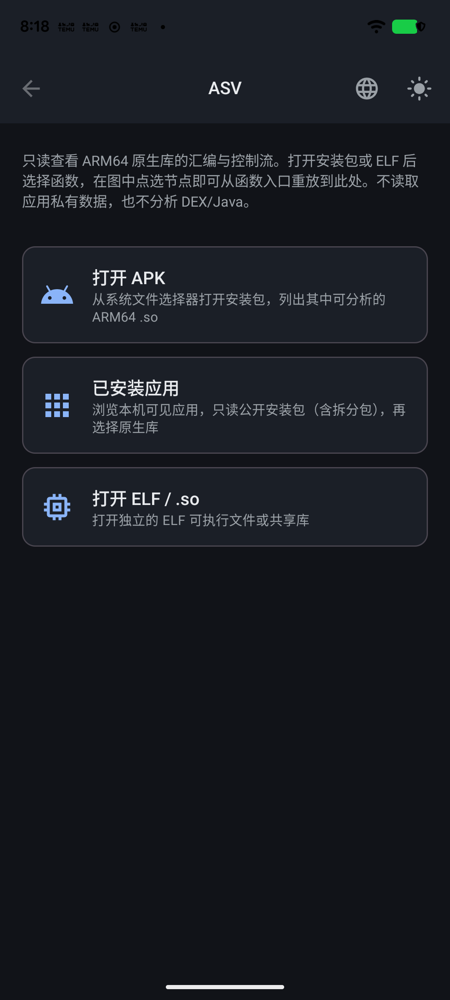
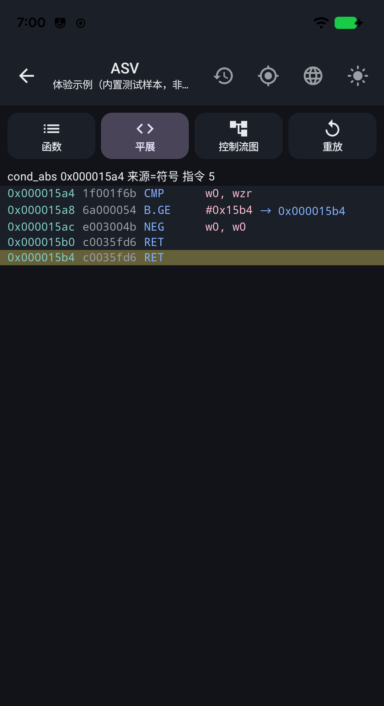
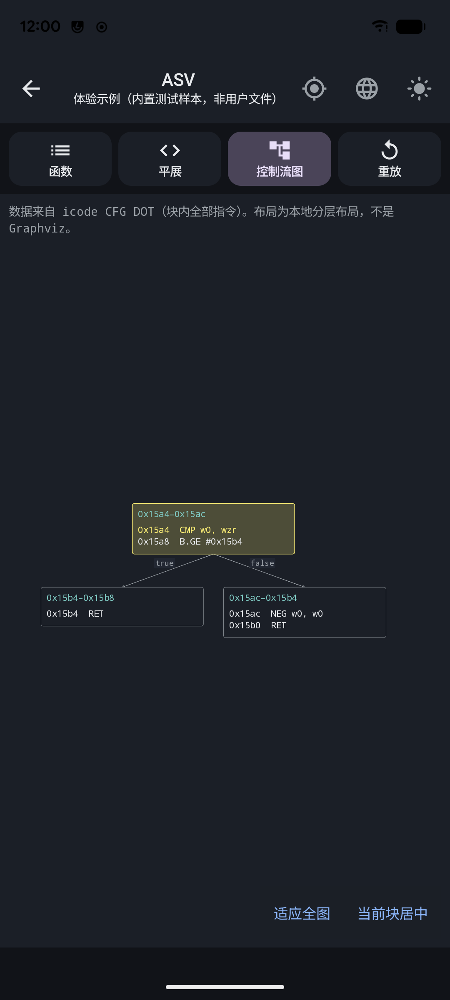
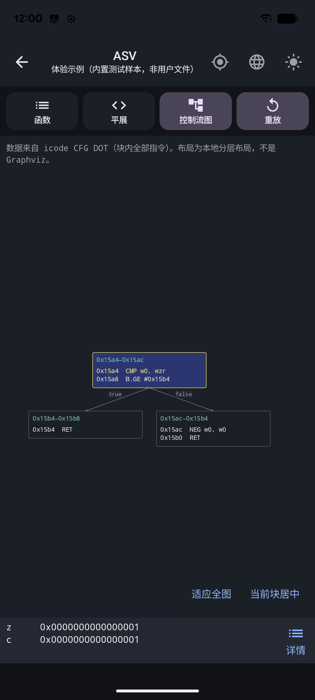
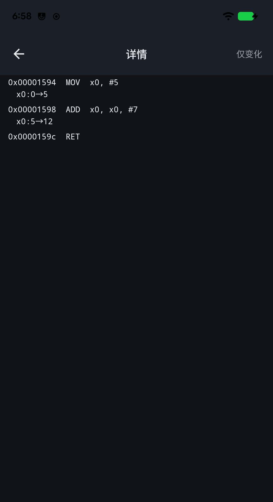

# ASV

ASV 是一款以手机为主的 Android 应用，用于查看 ARM64 ELF / `.so` 的汇编、平展列表、控制流图，以及只读的寄存器变化重放。重放使用默认执行环境（与间接分支求解同类的初始状态），没有手工修改寄存器的界面，适合用来观察解混淆过程中的值变化。

本仓库只包含 **应用工程**：Kotlin、资源、Gradle，以及 **预编译** 的 `libicode_jni.so`。这里 **没有** 分析引擎的源码、头文件、CMake 或静态库（`.a`）。正式 APK 也不进入 git，请从 GitHub Release 附件下载（若该版本的 Release 尚未发布，请使用本地 `assembleRelease` 产物）。

当前版本：**1.0.9**（versionCode 10）。ABI 仅 `arm64-v8a`。最低系统要求为 Android 8.0（API 24）；本版本的真机验证是在 Pixel 6 上完成的，**不能**据此声称已在 API 24 真机通过。

## 界面

以下截图来自实际界面（中文），不是示意图。1.0.9 的界面布局与 1.0.8 相同。

<p>





</p>

- 首页：打开 APK、已安装应用或独立 ELF / `.so`，也可加载内置测试样本。
- 平展：紧凑的地址 / 机器码 / 指令列表，长按一行即可复制。
- 控制流图：本地布局，可双指缩放和平移。
- 重放：从函数入口按实际会执行的指令往下走（包括分支，以及仍在当前镜像内的调用）。主结果只列出实际发生变化的寄存器；右侧「详情」打开全屏页，按执行顺序查看每条指令的值变化（例如 `x0:5→12`）。若在默认环境下走不到选中的指令，会明确提示未执行到，同时仍列出已经执行过的步骤。无法执行的指令会如实报失败，不会当成成功。

## 构建

需要 JDK 17、Android SDK（compile/target 35，min 24）和仓库自带的 Gradle wrapper（8.11.1）。首次构建需要访问 Google / Maven Central。

**不需要** 引擎源码树，也不需要 `ICODE_*` 环境变量，或用 CMake/NDK 编译本地引擎。

```bash
# 在不会提交的 local.properties 中设置：
#   sdk.dir=/path/to/Android/sdk

./gradlew :app:assembleDebug
./gradlew :app:assembleRelease
```

调试包输出在 `app/build/outputs/apk/debug/`，正式包在 `app/build/outputs/apk/release/`。请勿把 APK 提交进 git。

正式包需要本地签名配置，密码不要写入仓库。可设置环境变量 `ASV_RELEASE_SIGNING_PROPS`，指向一份未跟踪的 properties 文件，内含 `storeFile`、`storePassword`、`keyAlias`、`keyPassword`；也可使用本机默认的本地签名 properties 路径（不在仓库内）。

预编译库已放在 `app/src/main/jniLibs/arm64-v8a/libicode_jni.so`（以及 `libc++_shared.so`）。Kotlin 侧通过 `System.loadLibrary("icode_jni")` 加载。

## 限制与验证范围

- 重放是只读的，使用默认环境；没有寄存器编辑，也没有额外设置页。
- 重放只走默认环境下实际会走到的路径，不会强行执行未走到的分支。选中指令不在这条路径上时会提示未执行到，详情里仍会列出已经执行的步骤。镜像内可映射的调用会被跟进去；如果调用覆盖了返回地址、无法再返回调用处，不会虚构调用者后面的指令。
- 预编译引擎库 **并非** 由本仓库开源。该 so 已去掉 ELF 调试符号，但这 **不表示** 二进制不可逆向，其中仍可能残留第三方编译时的路径字符串。详见 `NOTICE`。
- 已在 Pixel 6 上对 1.0.9 的重放与详情做仪器测试（含算术、条件标志、栈、已走与未走的分支、间接目标、失败处理，以及全屏详情）。大型控制流图的压力测试和取消重放 **未能覆盖**（分析很快完成，未见取消按钮），不要把这两项写成已通过。
- 正式包与此前安装的 debug 包签名不同，不能当作同一应用的覆盖更新。

## 仪器测试

测试可通过 `am instrument` 在设备上运行。部分测试会从设备公共 Download 目录复制自造的 `libconst_twelve.so`（`Download/ASV-test` 或 `Download/icode-viewer-test`）。测试不读取引擎源码。
